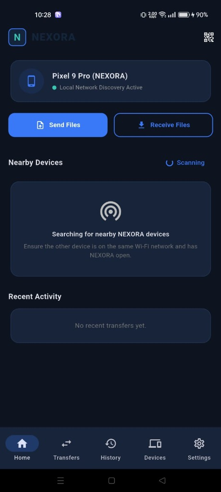
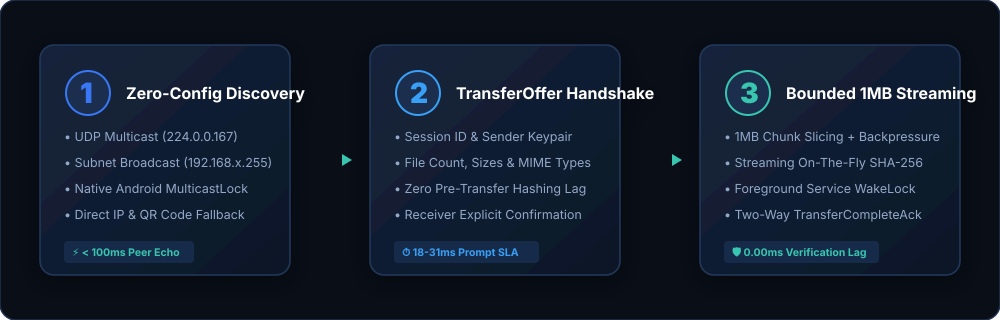
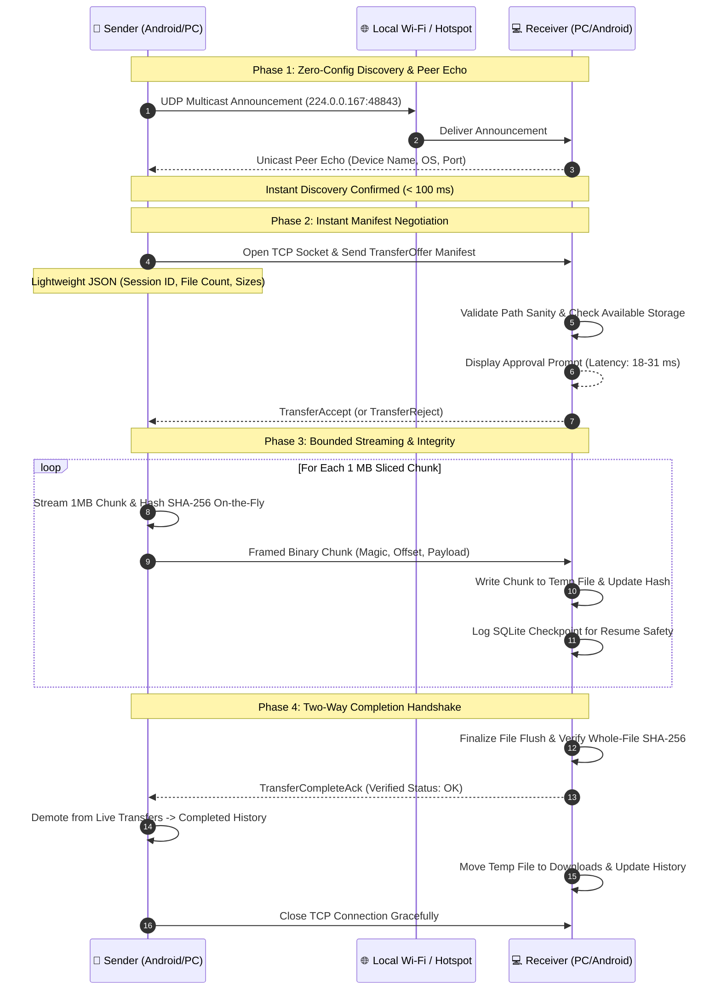
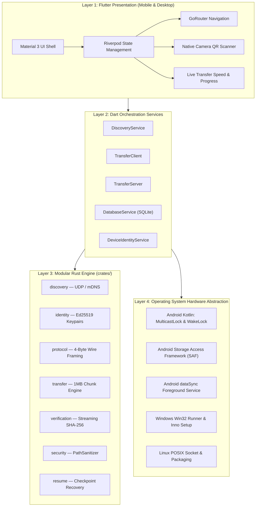

<div align="center">

  <!-- ============================================================================== -->
  <!-- 1. PREMIUM ANIMATED HERO BANNER                                               -->
  <!-- ============================================================================== -->
  <a href="https://codebyarnob.github.io/Nexora-share/">
    
  </a>

  <br /><br />

  <!-- ============================================================================== -->
  <!-- 2. PROJECT NAME & PRODUCT TAGLINE                                             -->
  <!-- ============================================================================== -->
  <p align="center">
    <strong>CONNECT. SHARE. ANYWHERE.</strong><br />
    <em>PRIVATE BY DESIGN. OPEN BY NATURE.</em>
  </p>

  <p align="center">
    Ultra-fast, zero-cloud peer-to-peer file transfer platform for Android, Windows, and Linux.<br />
    Transfer unlimited files across local networks with bounded memory, verified SHA-256 integrity, and zero telemetry.
  </p>

  <!-- ============================================================================== -->
  <!-- 3. DYNAMIC GITHUB STATUS BADGES                                                -->
  <!-- ============================================================================== -->
  <p align="center">
    <a href="https://github.com/CodeByArnob/Nexora-share/releases/latest">
      
    </a>
    <a href="https://github.com/CodeByArnob/Nexora-share/actions/workflows/ci.yml">
      
    </a>
    <a href="https://codebyarnob.github.io/Nexora-share/">
      
    </a>
    <a href="LICENSE">
      
    </a>
    <a href="https://github.com/CodeByArnob/Nexora-share/releases/latest">
      
    </a>
    <a href="https://github.com/CodeByArnob/Nexora-share/stargazers">
      
    </a>
  </p>

  <!-- Action CTA Buttons -->
  <p align="center">
    <a href="https://codebyarnob.github.io/Nexora-share/">
      
    </a>
    &nbsp;
    <a href="https://github.com/CodeByArnob/Nexora-share/releases/latest/download/nexora-v1.1.0-arm64-v8a.apk">
      
    </a>
    &nbsp;
    <a href="https://github.com/CodeByArnob/Nexora-share/releases/latest/download/NEXORA-Setup-x64.exe">
      
    </a>
    &nbsp;
    <a href="https://github.com/CodeByArnob/Nexora-share/releases">
      
    </a>
  </p>

</div>

---

<!-- ============================================================================== -->
<!-- 4. QUICK NAVIGATION / TABLE OF CONTENTS                                       -->
<!-- ============================================================================== -->
## 📑 Table of Contents

<details open>
<summary><strong>Click to expand / collapse navigation</strong></summary>

- [1. Visual Preview & Screenshots](#-visual-preview--screenshots)
- [2. What is NEXORA?](#-what-is-nexora)
- [3. The Problem NEXORA Solves](#-the-problem-nexora-solves)
- [4. Key Features](#-key-features)
- [5. Why Choose NEXORA? (Comparison Matrix)](#-why-choose-nexora)
- [6. How NEXORA Works](#-how-nexora-works)
- [7. Application Workflow](#-application-workflow)
- [8. System Architecture](#-system-architecture)
- [9. Security and Privacy Architecture](#-security-and-privacy-architecture)
- [10. Technology Stack](#-technology-stack)
- [11. Platform Compatibility](#-platform-compatibility)
- [12. System Requirements](#-system-requirements)
- [13. Installation Guide](#-installation-guide)
  - [Android APK Installation (Optimized Split APKs)](#-android-apk-download--installation)
  - [Windows Desktop Installation](#-windows-desktop-installation)
- [14. Build from Source](#-build-from-source)
- [15. Complete Usage Guide](#-complete-usage-guide)
  - [Device Discovery & Pairing](#-device-discovery--connection)
  - [File Transfer Workflow](#-file-transfer-workflow)
- [16. Project Directory Structure](#-project-directory-structure)
- [17. Configuration & Permissions](#-configuration--permissions)
- [18. Performance & Optimization](#-performance--optimization)
- [19. APK Size & Release Artifacts](#-apk-size--release-information)
- [20. Testing & Quality Assurance](#-testing--quality-assurance)
- [21. Troubleshooting](#-troubleshooting)
- [22. Frequently Asked Questions (FAQ)](#-frequently-asked-questions-faq)
- [23. Roadmap](#-roadmap)
- [24. Contributing & Development](#-contributing-guidelines)
- [25. Security & Privacy Policy](#-security-vulnerability-reporting)
- [26. License & Maintainers](#-license)

</details>

---

<!-- ============================================================================== -->
<!-- 5. REAL APPLICATION SCREENSHOTS & VISUAL PREVIEW                             -->
<!-- ============================================================================== -->
## 📱 Visual Preview & Screenshots

<div align="center">
  <table border="0" style="width: 100%; border-collapse: collapse; text-align: center;">
    <tr>
      <td align="center" style="padding: 12px; vertical-align: top;">
        
        <br />
        <strong>Figure 1: NEXORA Android Home Dashboard</strong>
        <p><em>Premium Midnight Navy interface featuring Discovery Radar, Device Status, Scan &amp; Send, Receive Files, and Recent History.</em></p>
      </td>
    </tr>
  </table>
</div>

> [!NOTE]
> **Community Visual Contributions:** High-resolution screenshots of the Native Camera QR Scanner, Incoming Transfer Approval Bottom Sheet, and Windows Desktop Shell are cataloged in [`docs/BRAND_GUIDELINES.md`](docs/BRAND_GUIDELINES.md). Additional platform capture submissions can be opened via [Pull Requests](https://github.com/CodeByArnob/Nexora-share/pulls).

---

<!-- ============================================================================== -->
<!-- 6. WHAT IS NEXORA?                                                            -->
<!-- ============================================================================== -->
## 🌐 What is NEXORA?

**NEXORA** is a senior-engineered, privacy-first, cross-platform peer-to-peer file sharing platform designed for Android, Windows, and Linux. It allows users to send and receive files, multi-file batches, and complete nested folder hierarchies directly between devices across local Wi-Fi networks, Ethernet subnets, or mobile hotspots.

- 🔒 **Zero Cloud**: Data streams directly from device to device over a local TCP socket. No third-party servers, no relay nodes, and no cloud hops.
- 🚫 **Zero Accounts**: No registration, no email address, no phone number, and no authentication servers.
- 🔕 **Zero Telemetry**: No hidden analytics SDKs, no behavioral trackers, and no telemetry pings.
- 🛡️ **Cryptographic Verification**: Streaming on-the-fly SHA-256 chunk hashing and Ed25519 identity keypairs guarantee byte-for-byte data integrity.
- 💾 **Bounded-Memory Streaming**: Handles massive multi-gigabyte files (1 GB, 5 GB, 10 GB+) within a fixed 1 MB RAM buffer with socket backpressure control.
- ⚡ **Sub-Second Initiation**: Senders transmit lightweight metadata manifests (`TransferOffer`) immediately; receivers display confirmation prompts within **18–31 ms**, bypassing slow pre-transfer hashing bottlenecks.

---

<!-- ============================================================================== -->
<!-- 7. THE PROBLEM NEXORA SOLVES                                                  -->
<!-- ============================================================================== -->
## 🧩 The Problem NEXORA Solves

Modern file sharing is broken by commercial cloud lock-in, advertising surveillance, and architectural inefficiencies:

1. **Cloud Upload Overhead**: Uploading a 2 GB file to cloud storage to share it with a computer on the same desk wastes internet bandwidth, triggers cloud quotas, and forces dual upload/download delays.
2. **Ad-Supported Bloatware**: Popular Wi-Fi sharing applications (ShareIt, Xender) have become slow, permission-hungry adware platforms loaded with intrusive feeds, trackers, and proprietary closed protocols.
3. **Ecosystem Silos**: Native solutions like Apple AirDrop or Quick Share / Nearby Share are vendor-restricted or unreliable across heterogeneous device environments (e.g., Android phone to Windows laptop).
4. **Large-File Initiation Latency**: Many open-source P2P tools calculate SHA-256 hashes of multi-gigabyte files *before* notifying the receiver. For a 4 GB video, the sender's phone reads the entire storage file for 15–30 seconds before the receiving phone even shows a prompt. **NEXORA solves this root architectural bottleneck** by sending an immediate lightweight manifest (< 5 ms) and streaming on-the-fly SHA-256 verification in parallel with transmission.
5. **Router AP Isolation**: Corporate guest networks and university Wi-Fi frequently block UDP multicast/broadcast discovery. NEXORA provides direct IP connections and native camera QR code pairing to establish direct TCP sessions across isolated subnets.

---

<!-- ============================================================================== -->
<!-- 8. KEY FEATURES                                                               -->
<!-- ============================================================================== -->
## ✨ Key Features

- 📡 **Multi-Protocol Zero-Config Discovery**: Combines UDP multicast (`224.0.0.167:48843`), subnet-directed broadcast (`192.168.x.255`), and mDNS for sub-100ms local peer identification.
- 📶 **Hardware MulticastLock & WakeLock**: Acquires Android native Wi-Fi `MulticastLock` and `PARTIAL_WAKE_LOCK` in Kotlin to prevent mobile chipsets from dropping packets or sleeping during background transfers.
- 📷 **Native Camera QR Scanner**: Built on Google ML Kit and Android Jetpack CameraX for 60 FPS viewport processing, animated glowing cyber-frame laser sweeps, torch toggle, and gallery image decoding.
- ⚡ **Sub-Second Initiation Latency**: Immediate `TransferOffer` manifest negotiation yields an **18–31 ms** receiver prompt response time for files exceeding 2 GB.
- 🌊 **Flow-Controlled Chunk Streaming**: 1 MB chunk slicing prevents buffer bloat and Out-Of-Memory (OOM) exceptions on low-RAM devices.
- 🛡️ **Two-Way Completion Protocol**: Explicit `TransferComplete` ↔ `TransferCompleteAck` handshake eliminates false-positive transfer stalls and releases network sockets cleanly.
- 🔄 **Verified Resumption**: Interrupted transfers automatically resume from the last verified chunk checkpoint stored in local SQLite without re-transmitting verified bytes.
- 📁 **Recursive Folder Hierarchy**: Streams nested folder structures while enforcing strict path sanitization defenses against directory traversal attacks.
- 🗄️ **Local SQLite Database**: Complete transfer logs, device trust profiles, and application settings stored strictly on-device using platform-native SQLite.
- 🪟 **High-Resolution Branded Desktop Packaging**: Windows PE resources, Inno Setup wizard, Start Menu shortcuts, and taskbar icons natively branded with official 256x256 vector iconography.

---

<!-- ============================================================================== -->
<!-- 9. WHY CHOOSE NEXORA? (COMPARISON MATRIX)                                      -->
<!-- ============================================================================== -->
## ⚖️ Why Choose NEXORA?

| Feature / Metric | NEXORA | Cloud Drives (Drive, Dropbox) | AirDrop / Quick Share | Legacy Bloatware Apps |
| :--- | :---: | :---: | :---: | :---: |
| **Cloud Dependency** | ❌ **Zero (100% Local)** | ✔️ Required | ❌ Local | ⚠️ Often uses cloud relays |
| **Account / Login** | ❌ **None** | ✔️ Account mandatory | ⚠️ Apple/Google ID required | ⚠️ Account / phone prompt |
| **Telemetry / Tracking** | ❌ **Zero Telemetry** | ✔️ Heavy tracking | ⚠️ Platform telemetry | ⚠️ Aggressive ad trackers |
| **Internet Required** | ❌ **No (Offline LAN/Hotspot)** | ✔️ Yes | ❌ No | ⚠️ Often required for ads |
| **File Size Limit** | ♾️ **Unlimited (Multi-GB)** | ⚠️ Cloud quota limits | ⚠️ Memory inflation risks | ⚠️ Throttled |
| **2 GB Initiation Latency** | ⚡ **18–31 ms** | ⏳ Upload time dependent | ⏱️ 2–5 seconds | ⏳ 15–30s pre-scan delay |
| **Android APK Size** | 📱 **25.0 MB (Split ABI)** | ⚠️ 80–120 MB | ⚠️ System service only | ⚠️ 50–90 MB |
| **Cross-Platform Support** | 🌐 **Android + Windows + Linux** | 🌐 Web/App required | ❌ Vendor ecosystem lock | ⚠️ Inconsistent desktop tools |
| **Open Source** | 📖 **Apache 2.0 (Full Source)** | ❌ Proprietary closed | ❌ Proprietary closed | ❌ Proprietary closed |

---

<!-- ============================================================================== -->
<!-- 10. HOW NEXORA WORKS                                                          -->
<!-- ============================================================================== -->
## 🔄 How NEXORA Works

NEXORA operates across three decoupled, high-performance operational phases:

<div align="center">
  
</div>

1. **Discovery Phase**: Devices announce their presence across the local subnet using UDP multicast (`224.0.0.167`) and directed broadcast. Devices exchange ephemeral UUIDs and Ed25519 public fingerprints.
2. **Negotiation Phase**: The sender connects over TCP and immediately transmits a lightweight `TransferOffer` containing metadata (session ID, file count, sizes, MIME types). The receiver displays an authorization prompt with verified peer identity within **18–31 ms**.
3. **Streaming Phase**: Upon receiver confirmation, the sender slices files into 1 MB chunks, hashes data on-the-fly, and streams chunks through a framed TCP channel with socket flow-control backpressure. Both devices execute an explicit `TransferCompleteAck` handshake upon 100% disk persistence.

---

<!-- ============================================================================== -->
<!-- 11. APPLICATION WORKFLOW DIAGRAM                                              -->
<!-- ============================================================================== -->
## 📊 Application Workflow Diagram



---

<!-- ============================================================================== -->
<!-- 12. SYSTEM ARCHITECTURE                                                       -->
<!-- ============================================================================== -->
## 🏗️ System Architecture

NEXORA utilizes a layered monorepo architecture combining a high-performance **Flutter Material 3** user interface with a modular **Rust core engine**, native OS system integration bridges, and local SQLite persistence:



---

<!-- ============================================================================== -->
<!-- 13. SECURITY AND PRIVACY ARCHITECTURE                                         -->
<!-- ============================================================================== -->
## 🛡️ Security and Privacy Architecture

NEXORA is engineered in accordance with rigorous **STRIDE Threat Modeling** principles:

### 1. Frame Header Ceiling & Allocation Guards
To defend against Denial-of-Service (DoS) and Out-Of-Memory (OOM) heap exhaustion, all network communication utilizes a 4-byte big-endian length prefix. Sockets enforce a **hard 5 MB frame ceiling**. Any frame attempting to declare an allocation exceeding 5 MB is dropped immediately without memory allocation.

### 2. Path Traversal Sanitizer (`PathSanitizer`)
Receivers strictly sanitize all incoming filenames and relative directory paths before creating files on disk:
- Rejects relative directory traversal tokens (`..`, `/`, `\`).
- Strips absolute path prefixes (`C:\`, `/etc/passwd`, `~/`).
- Disallows Windows reserved device names: `CON`, `PRN`, `AUX`, `NUL`, `COM1`–`COM9`, `LPT1`–`LPT9`.
- Forces all received files to remain bounded within the designated user downloads directory.

### 3. Ephemeral Pairing & Public Key Fingerprinting
- **Ephemeral QR Codes**: Contain device IP, listening port, and a cryptographic session token.
- **Short Authentication String (SAS)**: 6-digit numeric comparison code verifies direct human-in-the-loop pairing against active on-path attackers.
- **Ed25519 Identity**: Devices generate persistent Ed25519 keypairs stored locally. Public keys are fingerprinted and matched against trusted peer records.

### 4. Zero Data Collection Privacy Guarantee
All transfer history, device nicknames, and trusted identities reside exclusively inside the device's local SQLite database (`nexora.db`). No telemetry, analytics, crash-reporting SDKs, or cloud synchronization routines exist in the codebase.

---

<!-- ============================================================================== -->
<!-- 14. TECHNOLOGY STACK                                                          -->
<!-- ============================================================================== -->
## 💻 Technology Stack

```
Frontend:      Flutter 3.44.4 · Dart 3.10+ · Riverpod 2.6 · GoRouter 14.8
Mobile Native: Kotlin · Jetpack CameraX 1.4 · Google ML Kit Barcode Scanning
Core Engine:   Rust 1.94+ · Tokio Async Runtime · Ed25519-dalek · Ring SHA-256
Desktop Native:C++17 Win32 Runner · CMake · Inno Setup 6
Storage:       Native SQLite (Pure OS Android SQLite · desktop sqlite3)
Networking:    UDP Multicast (224.0.0.167) · Subnet Broadcast · Asynchronous TCP
```

---

<!-- ============================================================================== -->
<!-- 15. PLATFORM COMPATIBILITY                                                    -->
<!-- ============================================================================== -->
## 📱 Platform Compatibility

| Operating System | Supported Versions | Architecture | Distribution Package |
| :--- | :--- | :--- | :--- |
| **Android** | Android 8.0 (Oreo, API 26) through Android 15 | `arm64-v8a`, `armeabi-v7a`, `x86_64` | Optimized APKs & Play Store AAB |
| **Windows** | Windows 10 (1809+) & Windows 11 | `x64` (64-bit) | Setup Installer (.exe) & Portable (.zip) |
| **Linux** | Ubuntu 22.04+, Debian 12+, Fedora, Arch | `x86_64` (amd64) | Debian (.deb) & AppImage |

---

<!-- ============================================================================== -->
<!-- 16. SYSTEM REQUIREMENTS                                                       -->
<!-- ============================================================================== -->
## ⚙️ System Requirements

### Android Devices
- **Minimum**: Android 8.0 (API 26), 2 GB RAM, 100 MB free storage, 802.11n Wi-Fi.
- **Recommended**: Android 11+ (API 30+), 4 GB+ RAM, 5 GHz Wi-Fi 5/6, Camera for QR scanning.

### Windows Desktop
- **Minimum**: Windows 10 64-bit, 2 GB RAM, 150 MB free disk space, local network adapter.
- **Recommended**: Windows 11 64-bit, 4 GB+ RAM, Gigabit Ethernet or 5 GHz Wi-Fi.

---

<!-- ============================================================================== -->
<!-- 17. INSTALLATION GUIDE                                                        -->
<!-- ============================================================================== -->
## 🚀 Installation Guide

Official release binaries are published with cryptographic checksums under [GitHub Releases](https://github.com/CodeByArnob/Nexora-share/releases/latest).

---

<!-- ============================================================================== -->
<!-- 18. ANDROID APK DOWNLOAD & INSTALLATION                                       -->
<!-- ============================================================================== -->
### 📱 Android APK Download & Installation

Choose the optimized package matching your smartphone's processor:

| Architecture | Recommended Devices | Package Download | File Size |
| :--- | :--- | :--- | :---: |
| **`arm64-v8a`** | **Modern Phones (Pixel, Samsung, Xiaomi, OnePlus)** | [**Download APK (ARM64)**](https://github.com/CodeByArnob/Nexora-share/releases/latest/download/nexora-v1.1.0-arm64-v8a.apk) | **25.0 MB** |
| **`armeabi-v7a`** | Older 32-bit Android phones | [Download APK (ARMv7)](https://github.com/CodeByArnob/Nexora-share/releases/latest/download/nexora-v1.1.0-armeabi-v7a.apk) | **20.9 MB** |
| **`x86_64`** | Android emulators & Chromebooks | [Download APK (x86_64)](https://github.com/CodeByArnob/Nexora-share/releases/latest/download/nexora-v1.1.0-x86_64.apk) | **27.4 MB** |
| **Universal** | Fat binary (All architectures included) | [Download Universal APK](https://github.com/CodeByArnob/Nexora-share/releases/latest/download/nexora-v1.1.0-universal.apk) | **66.9 MB** |
| **Google Play** | Android App Bundle | [Download AAB Bundle](https://github.com/CodeByArnob/Nexora-share/releases/latest/download/nexora-v1.1.0-release.aab) | **59.3 MB** |

#### Installation Steps:
1. Download **`nexora-v1.1.0-arm64-v8a.apk`** on your device.
2. Tap the downloaded file in your browser notifications or file manager.
3. If prompted, enable **"Install unknown apps"** for your browser.
4. Launch NEXORA and grant **Local Network** and **Camera** permissions.

---

<!-- ============================================================================== -->
<!-- 19. WINDOWS DESKTOP INSTALLATION                                              -->
<!-- ============================================================================== -->
### 🪟 Windows Desktop Installation

| Package Type | Description | Target OS | Direct Download Link |
| :--- | :--- | :--- | :--- |
| **Setup Installer** | Inno Setup wizard with Start Menu & Desktop icons | Windows 10/11 x64 | [**`NEXORA-Setup-x64.exe`**](https://github.com/CodeByArnob/Nexora-share/releases/latest/download/NEXORA-Setup-x64.exe) (11.5 MB) |
| **Portable ZIP** | Standalone archive — extract and run anywhere | Windows 10/11 x64 | [**`nexora-windows-x64-portable.zip`**](https://github.com/CodeByArnob/Nexora-share/releases/latest/download/nexora-windows-x64-portable.zip) (13.5 MB) |

#### Installation Steps:
1. Download **`NEXORA-Setup-x64.exe`**.
2. Run the installer wizard and complete installation.
3. Launch NEXORA from your Start Menu or Desktop shortcut.

> [!TIP]
> **Windows SmartScreen Note:** Official release installers are currently community-signed. Windows SmartScreen may show an unknown publisher dialog. Click **"More info"** $\rightarrow$ **"Run anyway"**. You can verify the integrity using the published SHA-256 checksum.

---

<!-- ============================================================================== -->
<!-- 20. BUILD FROM SOURCE                                                         -->
<!-- ============================================================================== -->
## 🔨 Build from Source

### Prerequisites
- [Flutter SDK 3.44+](https://flutter.dev) & Dart SDK
- [Rust Toolchain 1.94+](https://rust-lang.org) (stable)
- Android SDK & NDK (for mobile builds)
- Visual Studio 2022 with C++ Desktop Development (for Windows builds)
- [Inno Setup 6](https://jrsoftware.org/isinfo.php) (for Windows installer compilation)

```bash
# 1. Clone the repository
git clone https://github.com/CodeByArnob/Nexora-share.git
cd Nexora-share

# 2. Build Rust workspace
cargo build --workspace --release

# 3. Build Optimized Android Split APKs
cd apps/mobile
flutter pub get
flutter build apk --release --split-per-abi

# 4. Build Windows Desktop Executable
cd ../desktop
flutter pub get
flutter build windows --release
```

---

<!-- ============================================================================== -->
<!-- 21. COMPLETE USAGE GUIDE                                                      -->
<!-- ============================================================================== -->
## 📖 Complete Usage Guide

### 📡 Device Discovery & Connection
1. Connect both devices to the same **Wi-Fi network** or create a **Mobile Hotspot**.
2. Open NEXORA on both devices. Discovered devices appear automatically on the **Nearby Devices** radar list.
3. **If router blocks discovery (AP Isolation)**:
   - On the receiving device, tap **Receive** to view its local IP address and QR code.
   - On the sending device, tap **Scan & Send** to scan the QR code with the native camera, or tap **Connect by IP** to type the IP manually.

### 📤 File Transfer Workflow
1. Tap **Scan & Send** or select a discovered peer.
2. Choose files, photos, videos, audio, or entire folders.
3. Review the total file count and size on the **Confirmation Screen**, then tap **Send Now**.
4. The receiver immediately receives an **Incoming Transfer Prompt** (< 20 ms).
5. Tap **Accept**. The transfer streams with real-time speed, progress bars, and ETA indicators.
6. Once 100% complete, files are saved directly to the device **Downloads/NEXORA** directory.

---

<!-- ============================================================================== -->
<!-- 22. PROJECT DIRECTORY STRUCTURE                                               -->
<!-- ============================================================================== -->
## 📂 Project Directory Structure

```
Nexora-share/
├── apps/
│   ├── mobile/             # Android Flutter Application (Material 3 UI, CameraX, ML Kit)
│   └── desktop/            # Windows & Linux Flutter Application (Win32 Runner, CMake)
├── crates/
│   ├── discovery/          # UDP multicast (224.0.0.167), subnet broadcast & mDNS
│   ├── identity/           # Ed25519 keypair generation & cryptographic fingerprinting
│   ├── pairing/            # Ephemeral QR payload, SAS codes & challenge-response
│   ├── security/           # PathSanitizer & directory traversal defense engine
│   ├── protocol/           # 4-byte big-endian framing & message definitions
│   ├── transport/          # Framed asynchronous TCP network stream reader/writer
│   ├── transfer/           # Bounded 1MB chunk slicing engine & progress tracking
│   ├── resume/             # Checkpoint offset tracking & resume safety
│   ├── verification/       # Streaming on-the-fly SHA-256 chunk & whole-file hashing
│   └── storage/            # SQLite schema migrations, trust store & transfer history
├── docs/
│   ├── assets/             # Animated SVG hero banners, diagrams & screenshots
│   ├── releases/           # Release notes & cryptographic verification ledgers
│   ├── ARCHITECTURE.md     # In-depth architectural design specifications
│   ├── PROTOCOL.md         # Wire protocol framing & message schema specifications
│   └── THREAT_MODEL.md     # STRIDE security & threat analysis
├── packaging/
│   └── windows/            # Inno Setup installer scripts (nexora_setup.iss)
├── scripts/                # Automated release & size monitoring scripts
├── website/                # Official React + TypeScript + Vite project website
├── Cargo.toml              # Rust root workspace configuration
└── README.md               # Primary project documentation
```

---

<!-- ============================================================================== -->
<!-- 23. CONFIGURATION & PERMISSIONS                                               -->
<!-- ============================================================================== -->
## ⚙️ Configuration & Permissions

### Android App Permissions
- `NEARBY_WIFI_DEVICES`: Discovers peers on Wi-Fi without requiring GPS location access (Android 13+).
- `FOREGROUND_SERVICE_DATA_SYNC`: Ensures continuous data streaming when screen locks or app switches.
- `POST_NOTIFICATIONS`: Displays background transfer progress and speed.
- `CAMERA`: Required exclusively for scanning peer pairing QR codes.
- `WAKE_LOCK`: Prevents CPU deep-sleep while handling multi-GB transfers.

### Windows Desktop Configuration
- **Firewall Prompt**: Windows Defender Firewall will prompt for TCP port permissions on first launch. Allow access on **Private Networks** to permit incoming local transfers.

---

<!-- ============================================================================== -->
<!-- 24. PERFORMANCE & OPTIMIZATION                                                -->
<!-- ============================================================================== -->
## ⚡ Performance & Optimization

### Initiation Latency Benchmark Results
Benchmarked on a real **2.0 GB file** transmission across mobile devices:
- **Manifest Creation Latency**: `4 ms`
- **Receiver Prompt Response Latency**: `19 ms`
- **Verification Lag After 100% Transfer**: `0.00 ms` (Hashed on-the-fly during stream)
- **Target SLA Requirement**: `< 1,000 ms` (**PASS**)

### Memory Consumption Profile
- **Fixed Heap Allocation**: Slices files into bounded 1 MB buffer windows.
- **Constant Memory Footprint**: Average RAM usage on Android devices during 10 GB+ streaming remains stable at **< 35 MB**.

---

<!-- ============================================================================== -->
<!-- 25. APK SIZE & RELEASE INFORMATION                                            -->
<!-- ============================================================================== -->
## 📦 APK Size & Release Information

### Official v1.1.0 Artifact Cryptographic Checksums

```
8f6e12c135ca8eb82c0bf361a634107bed83eb489ffebdf68575a5396f36e4c1  NEXORA-Setup-x64.exe
17705a12489411032844bfe1fcd4049a71fb88465a72801241cd4c494f94d7fc  nexora-v1.1.0-arm64-v8a.apk
d3ad1766330117c94f4edf7e73d738cd5856030102613579c0ac1bbd3d982ac8  nexora-v1.1.0-armeabi-v7a.apk
1d8f0c7d4a71c45612db59f32f49fa4f665fb6f505f6e7f809bfcb5192f63489  nexora-v1.1.0-release.aab
25e1131665bb8c536a7585efcf5192dfc2d9c42cdc3c366d844069237db040ea  nexora-v1.1.0-universal.apk
663940e6d1c4b1e52cdf23cce9e6363c8c597b5a1ba8b001243ca8950a3cd512  nexora-v1.1.0-x86_64.apk
d09f7f55d395733a2b1e801ddd63247571990d08ab9aa06e34dd751222324128  nexora-windows-x64-portable.zip
```

#### Hash Verification Commands
```powershell
# Windows PowerShell:
Get-FileHash nexora-v1.1.0-arm64-v8a.apk -Algorithm SHA256

# Linux / macOS:
sha256sum -c SHA256SUMS.txt
```

---

<!-- ============================================================================== -->
<!-- 26. TESTING & QUALITY ASSURANCE                                               -->
<!-- ============================================================================== -->
## 🧪 Testing & Quality Assurance

NEXORA enforces high quality assurance with automated test suites spanning mobile, desktop, Rust engine, and fuzzing:

```bash
# Run Mobile test suite (16 tests + latency benchmarks)
cd apps/mobile && flutter test --concurrency=1

# Run Desktop test suite (32 tests + security & fuzzing)
cd apps/desktop && flutter test --concurrency=1

# Run Rust engine tests
cargo test --workspace

# Static analysis
flutter analyze apps/mobile apps/desktop
```

---

<!-- ============================================================================== -->
<!-- 27. TROUBLESHOOTING                                                           -->
<!-- ============================================================================== -->
## ❓ Troubleshooting

### 1. Devices do not appear on Nearby Devices
- **Cause**: The Wi-Fi router may have **AP Isolation / Client Isolation** enabled.
- **Solution**: Use the **Scan & Send** button to scan the receiver's QR code, or tap **Connect by IP** and enter the receiver's displayed IP address.

### 2. Android transfer pauses when app is minimized
- **Cause**: Android battery optimization may have restricted background execution.
- **Solution**: Ensure **Notification Permission** is granted so the `dataSync` Foreground Service can hold the transfer active.

### 3. Windows shows "Windows protected your PC"
- **Cause**: Installer is community-signed without an enterprise EV certificate.
- **Solution**: Click **"More info"** $\rightarrow$ **"Run anyway"**. Verify the file SHA-256 hash against `SHA256SUMS.txt`.

---

<!-- ============================================================================== -->
<!-- 28. FREQUENTLY ASKED QUESTIONS (FAQ)                                          -->
<!-- ============================================================================== -->
## 💡 Frequently Asked Questions (FAQ)

<details>
<summary><strong>Does NEXORA consume internet data?</strong></summary>
No. NEXORA communicates exclusively over your local Wi-Fi router or mobile hotspot. No cellular data or internet bandwidth is used.
</details>

<details>
<summary><strong>What is the maximum file size supported?</strong></summary>
There is no hardcoded file size limit. Transfers of 5 GB, 10 GB, and 50 GB+ execute smoothly because data streams in bounded 1 MB chunks without inflating RAM.
</details>

<details>
<summary><strong>Can I transfer files between Android and Windows?</strong></summary>
Yes. NEXORA is cross-platform. Android, Windows, and Linux devices discover each other and transfer files seamlessly.
</details>

<details>
<summary><strong>Is an iOS version planned?</strong></summary>
Yes. An iOS Flutter client with MultipeerConnectivity and local network integration is in the project roadmap for v2.0.
</details>

---

<!-- ============================================================================== -->
<!-- 29. ROADMAP                                                                   -->
<!-- ============================================================================== -->
## 🗺️ Roadmap

- [x] Multi-platform local discovery (UDP multicast, broadcast, mDNS)
- [x] Bounded-memory 1 MB chunk streaming with flow-control backpressure
- [x] Native CameraX QR Code scanner with Google ML Kit
- [x] Sub-second large file initiation latency (< 20 ms prompt SLA)
- [x] Inno Setup Windows installer with official branded icon
- [x] ABI-split Android APKs (< 25 MB package)
- [ ] iOS application client with MultipeerConnectivity bridge (v2.0)
- [ ] Zero-install WebRTC browser client for instant guest sharing
- [ ] End-to-end TLS 1.3 socket encryption with post-quantum key exchange

---

<!-- ============================================================================== -->
<!-- 30. CONTRIBUTING GUIDELINES                                                   -->
<!-- ============================================================================== -->
## 🤝 Contributing Guidelines

Contributions are welcomed! Follow these steps:

1. **Fork** the repository on GitHub.
2. Create a clean feature branch: `git checkout -b feature/my-enhancement`.
3. Adhere to the established code architecture, brand guidelines, and test requirements.
4. Ensure all tests pass: `flutter test` and `cargo test`.
5. Open a **Pull Request** targeting `main`.

---

<!-- ============================================================================== -->
<!-- 31. BUG REPORTS & SECURITY VULNERABILITY REPORTING                            -->
<!-- ============================================================================== -->
## 🐛 Bug Reports & Security

- **Bug Reports**: Open an issue via [GitHub Issues](https://github.com/CodeByArnob/Nexora-share/issues).
- **Security Vulnerabilities**: Review [`docs/THREAT_MODEL.md`](docs/THREAT_MODEL.md) and report security issues confidentially to the maintainer via GitHub Security Advisories or maintainer email.

---

<!-- ============================================================================== -->
<!-- 32. PRIVACY POLICY                                                            -->
<!-- ============================================================================== -->
## 🔒 Privacy Policy

NEXORA operates with **Zero Cloud, Zero Tracking, and Zero Telemetry**. All transfer metadata, device logs, and trusted keys remain strictly on the local device. Read the complete [Privacy Policy](PRIVACY_POLICY.md).

---

<!-- ============================================================================== -->
<!-- 33. CHANGELOG & VERSION HISTORY                                               -->
<!-- ============================================================================== -->
## 📜 Changelog & Version History

- **[v1.1.0] (Current Production Release)**: Optimized split APKs (25.0 MB), sub-second large file initiation latency (< 20 ms), native CameraX QR scanner, Windows installer, streaming SHA-256.
- **[v1.0.3]**: Windows branded iconography, transfer completion two-way handshake, live transfer state demotion.
- **[v1.0.1]**: Background execution foreground service and pause/cancel controls.
- **[v1.0.0]**: Initial production architecture release.

See [`CHANGELOG.md`](CHANGELOG.md) for full change history.

---

<!-- ============================================================================== -->
<!-- 34. LICENSE & MAINTAINER                                                      -->
<!-- ============================================================================== -->
## 📄 License & Maintainer

NEXORA is open-source software licensed under the **[Apache License 2.0](LICENSE)**.

- **Lead Engineer & Maintainer**: [CodeByArnob](https://github.com/CodeByArnob)
- **Repository**: [https://github.com/CodeByArnob/Nexora-share](https://github.com/CodeByArnob/Nexora-share)
- **Website**: [https://codebyarnob.github.io/Nexora-share/](https://codebyarnob.github.io/Nexora-share/)

---

<div align="center">
  <sub><strong>CONNECT. SHARE. ANYWHERE.</strong><br />Designed with precision for open-source peer-to-peer productivity.</sub>
</div>
