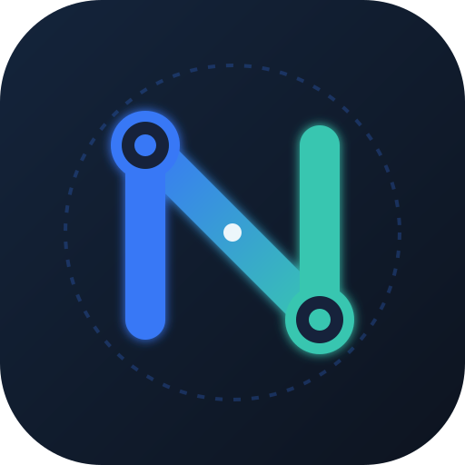

# NEXORA

<div align="center">
  
  <h3>CONNECT. SHARE. ANYWHERE.</h3>
  <p><strong>PRIVATE BY DESIGN. OPEN BY NATURE.</strong></p>
  <p>
    <a href="https://codebyarnob.github.io/Nexora-share/"></a>
    <a href="https://github.com/CodeByArnob/Nexora-share/releases/latest"></a>
    <a href="https://github.com/CodeByArnob/Nexora-share/releases/latest/download/nexora-v1.0.0-release.apk"></a>
    <a href="LICENSE"></a>
    
  </p>

  <p>
    <a href="https://codebyarnob.github.io/Nexora-share/">
      
    </a>
    &nbsp;&nbsp;
    <a href="https://github.com/CodeByArnob/Nexora-share/releases/latest/download/nexora-v1.0.0-release.apk">
      
    </a>
    &nbsp;&nbsp;
    <a href="https://github.com/CodeByArnob/Nexora-share/releases">
      
    </a>
  </p>
</div>

---

## 🌐 Official Project Links

- 🚀 **Live Website**: [https://codebyarnob.github.io/Nexora-share/](https://codebyarnob.github.io/Nexora-share/)
- 📱 **Direct APK Download**: [nexora-v1.0.0-release.apk](https://github.com/CodeByArnob/Nexora-share/releases/latest/download/nexora-v1.0.0-release.apk)
- 🔒 **Privacy Policy**: [https://codebyarnob.github.io/Nexora-share/privacy](https://codebyarnob.github.io/Nexora-share/privacy)
- 🛡️ **Security Policy**: [https://codebyarnob.github.io/Nexora-share/security](https://codebyarnob.github.io/Nexora-share/security)
- 📦 **Latest Release Notes**: [https://github.com/CodeByArnob/Nexora-share/releases/latest](https://github.com/CodeByArnob/Nexora-share/releases/latest)

---

## 📲 Download Latest APK

The latest tested, production-signed Android APK is always accessible directly from the **[GitHub Releases](https://github.com/CodeByArnob/Nexora-share/releases/latest)** section or the **[Official Website](https://codebyarnob.github.io/Nexora-share/)**.

| Package | Version | Platform | Size | SHA-256 Checksum | Download |
| :--- | :--- | :--- | :--- | :--- | :--- |
| **Universal Release APK** | `v1.0.0` (Build 100) | Android 8.0+ (ARM64, ARMv7, x86_64) | 54.4 MB | `669823bdfe58adb7c036880cfcab05eac6b7bbe97287351dd5e1c5ae2b83eb5b` | [**Download APK**](https://github.com/CodeByArnob/Nexora-share/releases/latest/download/nexora-v1.0.0-release.apk) |
| **Android App Bundle (AAB)** | `v1.0.0` (Build 100) | Google Play Distribution | 53.7 MB | `8f087e1d9f05a1987e1c75a54ca2849409c8257bac0903755a3747396e3f346b` | [**Download AAB**](https://github.com/CodeByArnob/Nexora-share/releases/latest/download/nexora-v1.0.0-release.aab) |
| **Integrity Ledger** | `v1.0.0` | All Packages | 170 B | Ledger verification | [**SHA256SUMS.txt**](https://github.com/CodeByArnob/Nexora-share/releases/latest/download/SHA256SUMS.txt) |

### Quick Android Installation Guide
1. Tap [**Download NEXORA for Android (APK)**](https://github.com/CodeByArnob/Nexora-share/releases/latest/download/nexora-v1.0.0-release.apk).
2. Open the downloaded file `nexora-v1.0.0-release.apk` on your phone.
3. When prompted, tap **Settings** and allow **"Install unknown apps"** for your browser or file manager.
4. Tap **Install** and launch **NEXORA**.
5. Connect both devices to the same Wi-Fi or Mobile Hotspot for instant peer discovery!

---

## 1. What is NEXORA?

NEXORA is a high-performance, privacy-first cross-platform peer-to-peer file sharing platform for Android, Windows, and Linux.

- **Zero Cloud**: Transfers occur directly between devices over your local Wi-Fi or LAN.
- **Zero Accounts**: No registration, no login, no central servers.
- **Zero Telemetry**: No hidden analytics or user behavior tracking.
- **Verified Integrity**: End-to-end cryptographic integrity verification via SHA-256 and Ed25519 signatures.
- **Bounded-Memory Streaming**: Handles multi-GB files (5GB, 10GB+) with fixed 1MB RAM buffers and receiver flow-control backpressure.
- **Reliable Background Transfer**: Android `dataSync` Foreground Service with WakeLock; desktop lifecycle persistence with SQLite checkpoint resumption.

---

## 2. Core Features

- **Local Discovery**: Instant zero-configuration local network discovery via UDP multicast (`224.0.0.167:48843`), subnet-directed broadcast (`192.168.x.255`), and mDNS.
- **Native Android MulticastLock**: Hardware-level Wi-Fi multicast lock prevents packet drops on Android power-saving chipsets.
- **Unique Device Identity**: Automated hardware model identification (`device_info_plus`) and persistent cryptographic UUID.
- **Direct IP & QR Pairing**: Connect directly by IP or QR code on corporate or guest networks with router AP Isolation / Client Isolation.
- **Secure Pairing**: Ephemeral QR pairing, 6-digit Short Authentication String (SAS) confirmation, and cryptographic challenge-response validation.
- **Receiver Approval**: Senders cannot push unapproved files; receivers inspect file manifests, sizes, and file counts before explicitly approving.
- **Folder & Multi-File Hierarchy**: Recursive directory streaming preserving relative folder structures with path traversal defenses.
- **Verified Resume**: Interrupted transfers automatically resume from the last verified chunk without retransmitting already-received data.
- **Trusted Device Management**: Store trusted peers with cryptographic public-key fingerprints for streamlined workflows.
- **Transfer History**: Complete local SQLite history recording transfer status, byte counts, and timestamps (never file contents).
- **Motion Design**: GPU-accelerated discovery radar pulse, animated transfer progress bars with live speed badges, and reduced-motion accessibility.

---

## 3. Technology Stack & Design System

- **User Interface**: Flutter & Dart (Material 3, Riverpod state management, GoRouter)
- **Palette**:
  - **Midnight Navy**: `#14243B`
  - **Electric Blue**: `#3978F6`
  - **Signal Teal**: `#39C6B0`
  - **Light Background**: `#F5F7FB`
  - **Dark Background**: `#0D1420`
  - **Dark Surface**: `#17243A`
- **Core Engine**: Rust (Zero-copy networking, async Tokio runtime, Ed25519 cryptographic identity, SHA-256 verification)
- **Native Android**: Kotlin (Foreground service with `WakeLock`, `MulticastLock`, Storage Access Framework, Share intents)
- **Native Desktop**: C++ / CMake runner for Windows & Linux
- **Storage**: SQLite with versioned migrations (`DatabaseService`)

---

## 4. Architecture

```
Flutter Material 3 UI (Mobile & Desktop)
                 │
       Application State (Riverpod)
                 │
        Typed Rust FFI Bridge
                 │
        NEXORA Rust Core Engine
  ┌──────────────┼──────────────┐
  │              │              │
Discovery    Identity        Transfer
(mDNS/UDP)   (Ed25519)      (1MB Chunks)
  │              │              │
Security     Pairing         Resume
(Traversal)   (QR / SAS)   (Checkpoints)
  │              │              │
Transport    Verification    Storage
(TCP/TLS)     (SHA-256)      (SQLite)
                 │
        Local Wi-Fi Network
                 │
        Remote NEXORA Peer
```

---

## 5. Security & Privacy

- **[Threat Model Specification](docs/THREAT_MODEL.md)**: Documented STRIDE threat analysis, asset classification, and mitigations.
- **[Privacy Policy](PRIVACY_POLICY.md)**: Zero telemetry, zero cloud, and strictly localized peer-to-peer data handling.
- **Hard Frame Ceiling**: 4-byte big-endian framing enforces a strict 5MB frame ceiling, instantly dropping oversized headers to prevent RAM exhaustion.
- **Path Sanitization**: `PathSanitizer` neutralizes directory traversal attacks (`..`, `C:\`, `/etc/passwd`, and Windows reserved device names `CON`, `PRN`, `AUX`, `NUL`).

---

## 6. Monorepo Organization

```
nexora-share/
  apps/
    mobile/         # Android Flutter application (io.github.codebyarnob.nexora)
    desktop/        # Windows & Linux Flutter desktop application
  crates/
    nexora_core/    # Core orchestrator and public engine API
    discovery/      # mDNS zero-config network discovery
    identity/       # Ed25519 keypair and device fingerprinting
    pairing/        # QR payload, SAS codes, challenge-response
    security/       # Path sanitization, nonces, replay guards
    protocol/       # Wire framing, message definitions, error codes
    transport/      # Framed async network stream reader/writer
    transfer/       # Streaming chunk engine, progress calculation
    resume/         # Chunk-level resume tracking & checkpoints
    verification/   # Streaming SHA-256 file and chunk integrity
    storage/        # SQLite persistence, migrations, history
  packaging/
    flatpak/        # Linux Flatpak packaging manifest
    appimage/       # Linux AppRun entrypoint
  scripts/          # Production release build automation scripts
  website/          # Production React + TypeScript + Vite project website
  assets/
    branding/       # Geometric N logo, platform icons, colors
  docs/             # Architectural, protocol, and testing specifications
  .github/          # CI/CD workflows and validation pipelines
```

---

## 7. Getting Started & Building

### Prerequisites
- [Flutter 3.44+](https://flutter.dev) & Dart SDK
- [Rust 1.94+](https://rust-lang.org) (stable)
- Android SDK & NDK (for mobile APK builds)
- Node.js 20+ (for website)

### Running Tests
```bash
# Run all Desktop & Linux test suites (28 tests)
cd apps/desktop
flutter test --concurrency=1

# Run all Android mobile test suites (11 tests)
cd apps/mobile
flutter test --concurrency=1

# Static analysis
flutter analyze apps/desktop apps/mobile
```

### Production Release Packaging

#### Android APK
```powershell
./scripts/build_android_apk.ps1               # Universal Release APK
./scripts/build_android_apk.ps1 -SplitPerAbi  # Split ABI APKs (ARM64, ARMv7, x86_64)
```

#### Windows Desktop
```powershell
./scripts/build_windows.ps1                   # Staged to dist/windows
```

#### Linux AppImage & Debian
```bash
./scripts/build_appimage.sh                   # Builds dist/NEXORA-x86_64.AppImage
./scripts/build_deb.sh                        # Builds dist/nexora_1.0.0_amd64.deb
```

---

## 8. License & Maintainer

- **Maintainer**: [CodeByArnob](https://github.com/CodeByArnob)
- **Repository**: [https://github.com/CodeByArnob/Nexora-share](https://github.com/CodeByArnob/Nexora-share)
- **Website**: [https://codebyarnob.github.io/Nexora-share/](https://codebyarnob.github.io/Nexora-share/)
- **License**: [Apache License 2.0](LICENSE)

*CONNECT. SHARE. ANYWHERE.*  
*PRIVATE BY DESIGN. OPEN BY NATURE.*
