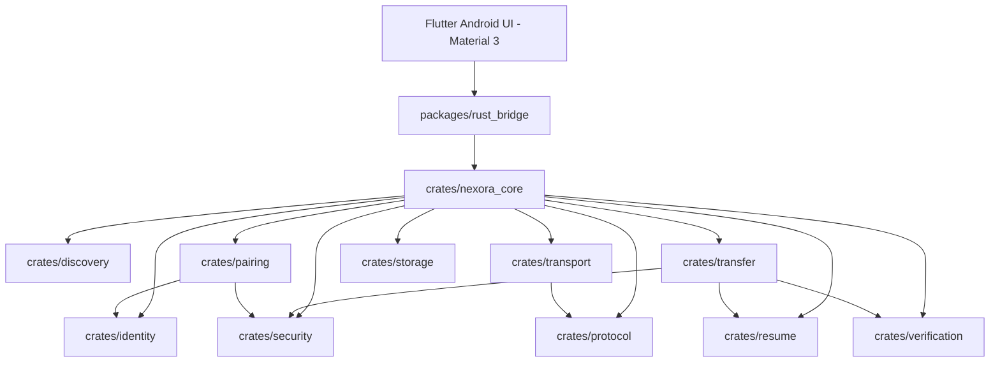
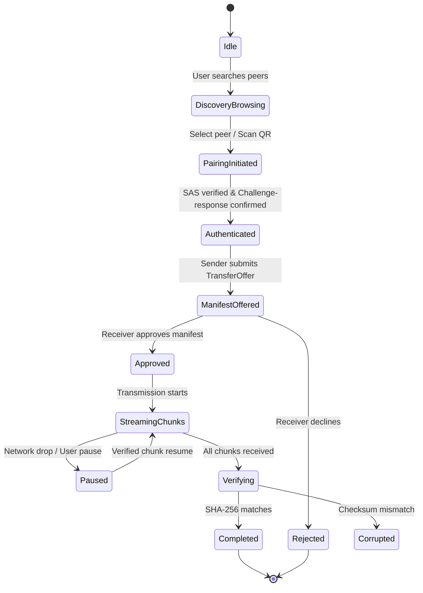
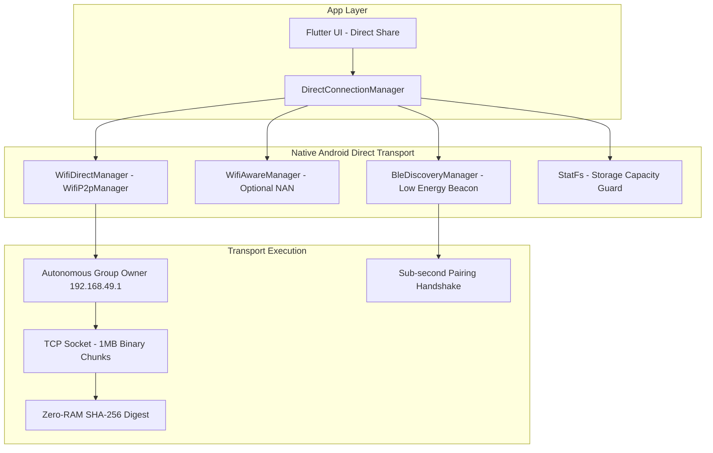

# NEXORA System Architecture

## 1. High-Level Architectural Principles

1. **Flutter Never Directly Speaks Raw Sockets**: Networking, encryption, session state machines, chunk streaming, and file integrity verification live strictly in the Rust core.
2. **Memory-Bounded Streaming**: Files are transferred in bounded chunk sizes (default 1 MiB) with flow control and backpressure. The system never loads entire multi-gigabyte files into memory.
3. **Explicit Consent & Defense-in-Depth**: No incoming file is written or executed without user approval. Path traversal sanitization, symlink escape detection, and OS reserved name prevention run on every file.
4. **Typed Bridge Boundaries**: Flutter communicates with Rust through typed, asynchronous data structures, structured error codes, and progress event streams.

---

## 2. Monorepo Crate & Package Topology

---

## 3. Crate Breakdown & Responsibilities

| Crate | Package Name | Responsibility |
|---|---|---|
| `nexora_core` | `nexora-core` | High-level application orchestrator, Flutter/FFI entry point, state coordination. |
| `discovery` | `nexora-discovery` | Zero-configuration mDNS / DNS-SD announcement (`_nexora._tcp.local.`), peer browsing, and stale peer eviction. |
| `identity` | `nexora-identity` | Ed25519 keypair generation, public key SHA-256 fingerprinting, cryptographic message signing and verification. |
| `pairing` | `nexora-pairing` | QR code payload generation/parsing, 6-digit Short Authentication String (SAS), and challenge-response handshake state machine. |
| `security` | `nexora-security` | Path traversal protection, Windows reserved filename sanitization, CSPRNG nonce generation, and replay attack guards. |
| `protocol` | `nexora-protocol` | Wire frame definitions, 4-byte length prefixing, schema validation, and official error code catalogue. |
| `transport` | `nexora-transport` | Asynchronous TCP/TLS framed stream reader and writer with bounded message sizes and timeouts. |
| `transfer` | `nexora-transfer` | Bounded file streaming, 1 MiB chunk reading/writing, exponential moving average speed and ETA computation. |
| `resume` | `nexora-resume` | Chunk-level resume tracking, verified chunk bitsets, and checkpoint serialization. |
| `verification` | `nexora-verification` | Streaming SHA-256 computation and chunk hash validation. |
| `storage` | `nexora-storage` | SQLite database, schema migrations, trusted device records, and transfer history. |

---

## 4. Transfer State Machine

---

## 5. Next-Generation Android Direct Share Engine

NEXORA features a multi-transport direct sharing architecture engineered specifically for router-free, mobile hotspot-free Android peer-to-peer data transmission:

### Transport Hierarchy & Fallback Policy:
1. **Wi-Fi Direct (`WifiP2pManager`) - Priority 1**: Establishes high-speed (50–150+ MB/s) IEEE 802.11ac/ax peer-to-peer links without requiring an external AP, router, or manually enabled hotspot. The receiver acts as autonomous Group Owner (`192.168.49.1`).
2. **Wi-Fi Aware (`WifiAwareManager`) - Priority 2**: Engaged on compatible Android 8.0+ hardware for low-power neighbor discovery and NAN data paths.
3. **Bluetooth Low Energy (BLE) Assisted Pairing**: Low-latency advertising of device credentials and connection tokens. BLE is strictly an out-of-band discovery assistant and is **never** used for large-file payload transmission.
4. **Local Network TCP/IP - Fallback**: Engaged when devices are already co-located on the same Wi-Fi router or hotspot.
5. **Storage Capacity Guard (`StatFs`)**: Pre-transfer validation ensures the destination filesystem has sufficient free bytes before accepting transmission offers.

